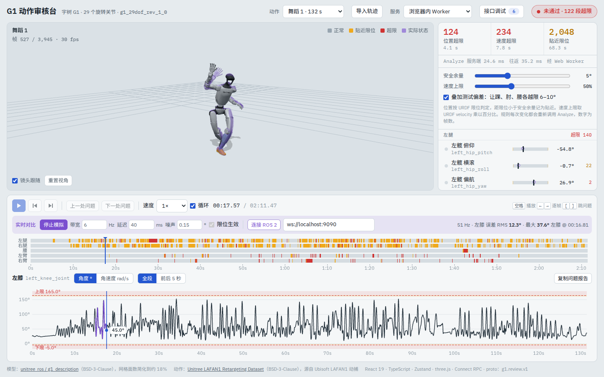
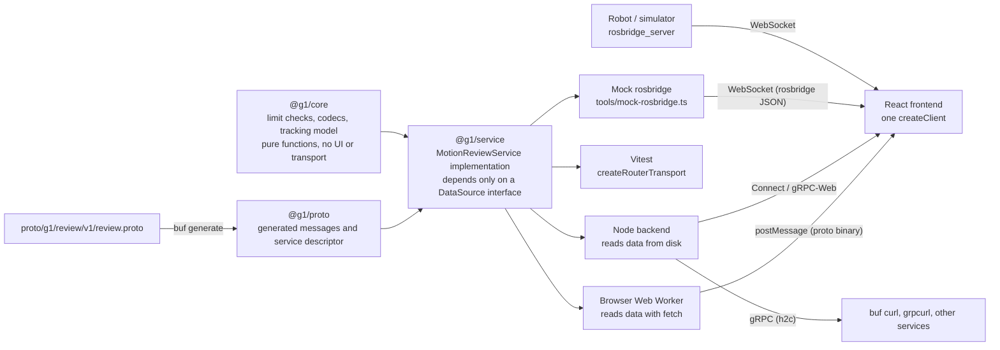

# G1 Motion Review

English | [简体中文](README.zh-CN.md)

Can a retargeted humanoid motion run on the real robot as-is? This tool loads the open-source URDF of the Unitree G1, checks every frame against joint position and velocity limits, marks problems on the 3D model, the timeline and per-joint curves, and overlays joint states streamed back from the "robot" on the planned trajectory.



- Frontend: React 19 + TypeScript + Zustand + three.js (`urdf-loader`)
- API: proto-first; `buf generate` produces TypeScript, called through Connect RPC
- One service implementation runs in three places: a browser Web Worker, a Node backend and the unit tests
- The Node backend speaks Connect, gRPC-Web and native gRPC
- Subscribes to ROS 2 `/joint_states` through rosbridge, with a mock rosbridge for machines without ROS

The UI is in Chinese. Labels referenced below are written as 中文 (English).

## Quick start

Requires Node 22.

```bash
npm ci
npm run dev            # http://localhost:5173, uses the in-browser Worker by default, no backend needed
```

To try the backend and ROS, open two more terminals:

```bash
npm run dev:server     # 8080: Connect / gRPC-Web (for the browser); 8081: native gRPC (h2c)
npm run mock:ros       # ws://localhost:9090, mock rosbridge publishing /joint_states
```

In the page header, switch 服务 (Service) to 本地后端 (local backend). In the 实时对比 (live comparison) bar at the bottom, click 模拟真机 (simulate robot) or 连接 ROS 2 (connect ROS 2).

Other commands:

```bash
npm test               # Vitest: core algorithms and the service implementation (29 tests)
npm run typecheck      # tsc in each package
npm run lint           # ESLint
npm run lint:proto     # buf lint
npm run generate       # regenerate packages/proto/src/gen after editing the proto
npm run build          # static build to apps/web/dist, ready for GitHub Pages
```

## Deploy to Cloudflare Pages

The live demo is a standalone Pages project, `jason-g1-review` (see `wrangler.jsonc`; it publishes `apps/web/dist`). It only uses the in-browser Worker service and needs no backend. The portfolio site loads it in a modal by its subdomain.

```powershell
npm ci
npx wrangler whoami      # check that you are logged in; if not, run npx wrangler login first
npm run pages:create     # first time only: creates the Pages project with production branch master
npm run deploy           # build and publish to production (npm run deploy:preview publishes to the preview branch)
```

- The default URL is https://jason-g1-review.pages.dev/ . If the name is taken, Cloudflare adds a suffix: use the URL printed by the command and update the portfolio's `apps/portfolio/demos.config.ts`. Update it there as well after binding your own subdomain.
- Do not add `X-Frame-Options` or `frame-ancestors` in `apps/web/public/_headers`: the portfolio embeds this site in an iframe. Cloudflare Pages sends `Access-Control-Allow-Origin: *` by default, which the portfolio's micro-app relies on to read this site's assets cross-origin.
- The build uses relative paths (`base: './'`) and data URLs are resolved against `document.baseURI`. When the site is embedded in the portfolio modal, micro-app points that base at this site, so no code changes are needed.

## Architecture



The frontend only knows `createClient(MotionReviewService, transport)`. With the in-browser Worker, the transport sends proto binary to the Worker through `postMessage`, and the Worker runs the same service that the Node backend registers. With the local backend, the transport becomes `createConnectTransport` or `createGrpcWebTransport`. The statically hosted demo and the backend-connected dev build therefore behave identically.

## API

The full definition is in [`proto/g1/review/v1/review.proto`](proto/g1/review/v1/review.proto) (comments are in Chinese).

| Method | Kind | Purpose |
| --- | --- | --- |
| `GetRobot` | Unary | Joint order, URDF limits and the URDF file path |
| `ListClips` | Unary | Motions available on the server |
| `GetClip` | Unary | The full trajectory of one motion |
| `Analyze` | Unary | Reviews a server-side motion or an uploaded trajectory against the rules; returns the verdict, problem segments and per-frame status |
| `StreamJointStates` | Server streaming | Simulates the robot tracking a trajectory and streams joint states at a fixed rate (shaped like `sensor_msgs/JointState`) |

Design notes:

- **Large arrays as `bytes`**: joint angles are little-endian float32 bytes rather than `repeated double`. Dance 1 has 3,945 frames × 29 joints, which packs into 457 KB; `repeated double` would double that.
- **One status byte per joint per frame**: in `frame_status`, the low 2 bits hold the position state (ok, near limit, over limit) and bit 3 flags a velocity violation. The frontend uses it directly to color the model and the timeline; batch reviews can turn it off.
- **By id or by value**: the source of `Analyze` and `StreamJointStates` is `oneof { clip_id, trajectory }`, so a locally imported CSV is uploaded with the request.
- **Standard status codes**: an unknown motion returns `NOT_FOUND`; data of the wrong length returns `INVALID_ARGUMENT`.
- **Compatibility checks**: CI runs `buf breaking` on pull requests so existing fields cannot be broken.

With the backend running, you can call it from a terminal:

```bash
# Connect protocol: HTTP/1.1 + JSON, plain curl works
curl -s -X POST -H 'content-type: application/json' \
  -d '{"clipId":"dance1_subject2","rules":{"marginRad":0.0873,"velocityFactor":0.5}}' \
  http://localhost:8080/g1.review.v1.MotionReviewService/Analyze

# Native gRPC (port 8081, h2c)
npx buf curl --protocol grpc --http2-prior-knowledge --schema proto --data '{}' \
  http://localhost:8081/g1.review.v1.MotionReviewService/ListClips

# Server streaming
npx buf curl --schema proto --data '{"clipId":"jumps1_subject1","rateHz":20}' \
  http://localhost:8080/g1.review.v1.MotionReviewService/StreamJointStates
```

The 接口调试 (API inspector) button at the top right lists every call's request, response, duration and size, and generates the matching `buf curl` command.

## Review rules

- **Position**: more than 1e-4 rad beyond a URDF limit counts as over the limit; closer to a limit than the safety margin (default 5°) counts as near the limit. Retargeted data often sits exactly on a limit, hence the tolerance.
- **Velocity**: angular velocity comes from central differences; anything above the URDF `velocity` × a factor (default 50%) is a violation. The URDF `velocity` is usually the motor's no-load maximum and deployments derate it, so set the factor to your deployment value.
- **Problem segments**: violating frames no more than 3 frames apart are merged into one segment, and the joints in a segment are ranked by excess and velocity ratio.
- **Test deviation**: Unitree's retargeted data is already clamped to the limits. The checkbox adds a smooth bump 6–10° past the limit on the left ankle roll, right elbow and waist pitch, to exercise the over-limit highlighting end to end.

One review of 7,355 frames × 29 joints takes about 3–5 ms on a 2.1 GHz Xeon (Node, after warm-up).

## Live comparison

模拟真机 (simulate robot) calls `StreamJointStates`. The server runs a first-order tracking model of the robot executing the motion, with bandwidth, latency, encoder noise, and optional position and velocity limits. Where the plan exceeds a limit or moves too fast, the actual angle cannot keep up and the tracking error grows right there. In the 3D view the actual state is a translucent robot, on the curve it is a purple line, and in the joint list it is a hollow dot.

连接 ROS 2 (connect ROS 2) subscribes to `/joint_states` (`sensor_msgs/msg/JointState`) through rosbridge, matches joints by name and aligns the first message with the start of the motion. On the robot or simulator, run:

```bash
ros2 launch rosbridge_server rosbridge_websocket_launch.xml   # ws://localhost:9090 by default
```

Without ROS, use `npm run mock:ros`. It speaks the same rosbridge protocol, and its data comes from the same `StreamJointStates`.

## Import formats

- **CSV**: 36 columns per row (root x y z qx qy qz qw, then 29 joint angles in radians), in the same column order as the Unitree LAFAN1 retargeting dataset; or 29 columns with joints only. A header row is allowed. Parsed at 30 fps.
- **JSON**: `{"fps":30,"joints":[joint names],"frames":[[…]],"root":[[…]],"events":[…]}`, matched by joint name.
- **JSON with only `events`**: overlaid on the current motion as an extra timeline row. The format is shared with peripherals such as a face display: `{"t":1.5,"type":"face","name":"happy"}`.

## Layout

```
proto/g1/review/v1/review.proto   API definition
packages/proto                    generated TypeScript (committed; CI checks it is up to date)
packages/core                     algorithms: joint table, URDF limits, review, codecs, tracking model, report
packages/service                  service implementation and proto conversion
apps/server                       Node backend (connect-node)
apps/web                          React frontend; public/data holds the robot model and motions
  src/api                         Worker transport, API inspector, client factory
  src/store                       Zustand stores: review, playback, live data
  src/three                       three.js scene, independent of React
  src/components                  UI components
tools/mock-rosbridge.ts           mock rosbridge
```

## Implementation notes

- **Rendering bypasses React state.** Playback time changes every frame, so the 3D scene and the two canvases run their own `requestAnimationFrame` loops and read state straight from the store. DOM components such as the joint list use throttled time and re-render at most 15 times per second.
- **Display and review use the same trajectory.** With the test deviation on, the trajectory reviewed by the service and the one shown in the browser come from the same `@g1/core` function, so highlights always match the data.
- **`urdf-loader` clamps joint values to their limits by default.** The page turns on `ignoreLimits` for every joint so the model shows the actual commanded values.
- **URDF is Z-up and three.js is Y-up**, so the robot sits in a group rotated -90° about X.
- **Meshes are pre-simplified** to about 18% of their faces and packed into one JSON file (Float32 vertices + indices) fetched in a single request: 19.7 MB down to 1.2 MB. They are for preview only and unsuitable for collision checks.
- **Results match the original single-file vanilla JS version exactly** (see the parity test in `packages/service/test/service.test.ts`), so the rewrite did not change any verdict.

## Roadmap

- Foot checks for ground penetration, floating and sliding (the URDF has collision spheres at the four corners of each sole), plus center-of-mass projection against the support polygon
- Auto-fix: clamping to limits plus velocity-constrained smoothing, with a before/after overlay
- Batch review of a whole directory of motions
- MCAP import
- Tauri desktop build
- Review and fix exposed as tools an agent can call

## Data and licenses

- Code: MIT
- Robot model: [unitree_ros / g1_description](https://github.com/unitreerobotics/unitree_ros/tree/master/robots/g1_description), BSD-3-Clause, meshes simplified
- Motions: [Unitree LAFAN1 Retargeting Dataset](https://huggingface.co/datasets/lvhaidong/LAFAN1_Retargeting_Dataset), BSD-3-Clause, derived from Ubisoft LAFAN1 motion capture
