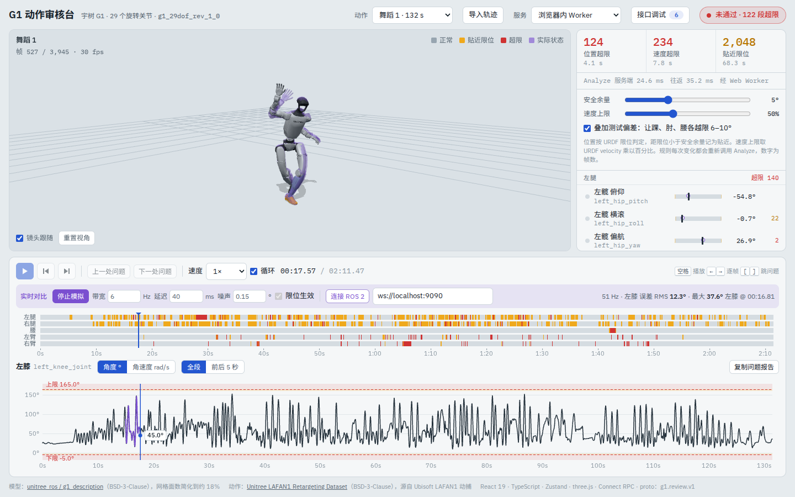
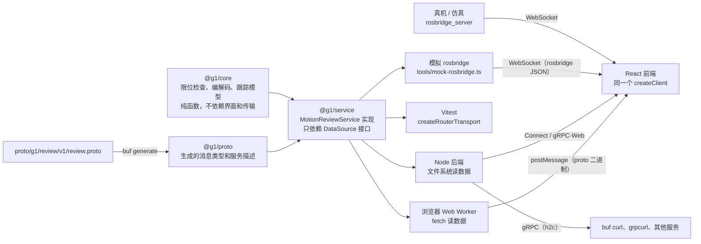

# G1 动作审核台

[English](README.md) | 简体中文

重定向出来的人形机器人动作，能不能直接上真机？这个工具加载宇树 G1 的开源 URDF，逐帧检查关节限位和速度，在三维模型、时间轴和关节曲线上标出问题，再把"真机"推回来的关节状态叠在规划轨迹上对比。



- 前端：React 19 + TypeScript + Zustand + three.js（`urdf-loader`）
- 接口：proto 先行，`buf generate` 生成 TypeScript，Connect RPC 调用
- 同一份服务实现跑在三个地方：浏览器 Web Worker、Node 后端、单元测试
- Node 后端同时支持 Connect、gRPC-Web 和原生 gRPC
- 通过 rosbridge 订阅 ROS 2 的 `/joint_states`，附带不装 ROS 也能用的模拟 rosbridge

## 快速开始

需要 Node 22。

```bash
npm ci
npm run dev            # http://localhost:5173，默认用浏览器内 Worker，不需要后端
```

想连后端和 ROS，再开两个终端：

```bash
npm run dev:server     # 8080：Connect / gRPC-Web（给浏览器）；8081：原生 gRPC（h2c）
npm run mock:ros       # ws://localhost:9090，模拟 rosbridge，推送 /joint_states
```

页面顶部"服务"切到"本地后端"，底部"实时对比"里点"模拟真机"或"连接 ROS 2"。

其他命令：

```bash
npm test               # Vitest：core 算法、服务实现（29 个用例）
npm run typecheck      # 各个包分别跑 tsc
npm run lint           # ESLint
npm run lint:proto     # buf lint
npm run generate       # 改了 proto 之后重新生成 packages/proto/src/gen
npm run build          # 构建静态页面到 apps/web/dist，可以直接放到 GitHub Pages
```

## 部署到 Cloudflare Pages

在线版是独立的 Pages 项目 `jason-g1-review`（见 `wrangler.jsonc`，发布 `apps/web/dist`），只用浏览器内 Worker 这一种服务，不需要后端。作品集主站按它的子域名在弹窗里加载：

```powershell
npm ci
npx wrangler whoami      # 确认已登录；没登录先 npx wrangler login
npm run pages:create     # 只在第一次执行：创建 Pages 项目，生产分支 master
npm run deploy           # 构建并发布到生产分支（npm run deploy:preview 发布到 preview 分支）
```

- 默认地址 https://jason-g1-review.pages.dev/ 。名字被占用时 Cloudflare 会加后缀，以命令输出为准，并同步修改作品集的 `apps/portfolio/demos.config.ts`；绑定自己的子域名后也改那里。
- `apps/web/public/_headers` 里不要加 `X-Frame-Options` / `frame-ancestors`：作品集的 iframe 加载方式需要能嵌入本站。Cloudflare Pages 默认带 `Access-Control-Allow-Origin: *`，主站的 micro-app 靠它跨域读取本站资源。
- 构建用相对路径（`base: './'`），数据地址基于 `document.baseURI`，嵌在作品集弹窗里时 micro-app 会把它指向本站，不用改代码。

## 架构



前端只认 `createClient(MotionReviewService, transport)`。选"浏览器内 Worker"时，transport 把 proto 二进制通过 `postMessage` 发给 Worker，Worker 里跑的就是 Node 后端注册的同一个服务；选"本地后端"时换成 `createConnectTransport` 或 `createGrpcWebTransport`。所以静态托管的在线版和连后端的开发版，行为完全一致。

## 接口

完整定义见 [`proto/g1/review/v1/review.proto`](proto/g1/review/v1/review.proto)。

| 方法 | 类型 | 作用 |
| --- | --- | --- |
| `GetRobot` | 一元 | 关节顺序和 URDF 限位，以及 URDF 文件路径 |
| `ListClips` | 一元 | 服务端已有的动作 |
| `GetClip` | 一元 | 一段动作的完整轨迹 |
| `Analyze` | 一元 | 按规则审核服务端动作或客户端上传的轨迹，返回结论、问题段和逐帧状态 |
| `StreamJointStates` | 服务端流 | 模拟真机跟踪一段轨迹，按固定频率推送关节状态（结构对应 `sensor_msgs/JointState`） |

几个设计点：

- **大数组用 `bytes`**：关节角是 float32 小端字节，不用 `repeated double`。舞蹈 1 有 3,945 帧 × 29 个关节，打包后 457 KB，用 `repeated double` 要翻一倍。
- **逐帧状态一个字节**：`frame_status` 每个关节每帧 1 字节，低 2 位是位置状态（正常、贴近、超限），第 3 位是速度超限。前端直接拿来给模型和时间轴着色，批量审核时可以关掉。
- **一个请求既能按 id 也能带数据**：`Analyze` 和 `StreamJointStates` 的来源是 `oneof { clip_id, trajectory }`，本地导入的 CSV 整条随请求上传。
- **错误用标准状态码**：动作不存在返回 `NOT_FOUND`，数据长度不对返回 `INVALID_ARGUMENT`。
- **兼容性检查**：CI 在 PR 上跑 `buf breaking`，防止改坏已有字段。

后端启动后可以直接在终端调用：

```bash
# Connect 协议，HTTP/1.1 + JSON，curl 就能调
curl -s -X POST -H 'content-type: application/json' \
  -d '{"clipId":"dance1_subject2","rules":{"marginRad":0.0873,"velocityFactor":0.5}}' \
  http://localhost:8080/g1.review.v1.MotionReviewService/Analyze

# 原生 gRPC（8081 端口，h2c）
npx buf curl --protocol grpc --http2-prior-knowledge --schema proto --data '{}' \
  http://localhost:8081/g1.review.v1.MotionReviewService/ListClips

# 服务端流
npx buf curl --schema proto --data '{"clipId":"jumps1_subject1","rateHz":20}' \
  http://localhost:8080/g1.review.v1.MotionReviewService/StreamJointStates
```

页面右上角"接口调试"会列出每次调用的请求、响应、耗时和字节数，并生成对应的 `buf curl` 命令。

## 检查规则

- **位置**：超出 URDF 限位 1e-4 rad 以上算超限；距离限位小于安全余量（默认 5°）算贴近。重定向数据经常正好停在限位上，所以留了容差。
- **速度**：中心差分求角速度，超过 URDF `velocity` × 系数（默认 50%）算超限。URDF 里的 `velocity` 通常是电机空载最高速度，实际部署一般要打折，系数请按你们的部署值设置。
- **问题段**：超限帧间隔不超过 3 帧的合并成一段，段内按越限量和速度比排序。
- **测试偏差**：宇树的重定向数据已经把角度卡在限位内，勾选后会在左踝横滚、右肘、腰俯仰上各叠加一个越限 6–10° 的平滑鼓包，用来验证超限高亮这条链路。

在一台 2.1 GHz 的 Xeon 上，7,355 帧 × 29 个关节的一次审核约 3–5 ms（Node，热身后）。

## 实时对比

"模拟真机"调用 `StreamJointStates`：服务端用一阶跟踪模型模拟真机执行这段动作，参数有带宽、延迟、编码器噪声、是否受限位和速度约束。规划轨迹超限或过快的地方，实际角度跟不上，跟踪误差就在那里变大。三维视图里实际状态是一个半透明的机器人，曲线上是紫色线，关节列表里是空心圆点。

"连接 ROS 2"通过 rosbridge 订阅 `/joint_states`（`sensor_msgs/msg/JointState`），按关节名对齐，第一条消息对齐到动作开头。真机或仿真端运行：

```bash
ros2 launch rosbridge_server rosbridge_websocket_launch.xml   # 默认 ws://localhost:9090
```

没有 ROS 环境时用 `npm run mock:ros`，它说的是同一套 rosbridge 协议，数据来自同一个 `StreamJointStates`。

## 导入格式

- **CSV**：每行 36 列（根节点 x y z qx qy qz qw，然后 29 个关节角，弧度），列序与宇树 LAFAN1 重定向数据集相同；或者 29 列只含关节。可以有表头，按 30 fps 解析。
- **JSON**：`{"fps":30,"joints":[关节名],"frames":[[…]],"root":[[…]],"events":[…]}`，按关节名对齐。
- **只含 `events` 的 JSON**：叠加到当前动作上，时间轴多出一行事件。格式与表情屏等外设共用：`{"t":1.5,"type":"face","name":"happy"}`。

## 目录

```
proto/g1/review/v1/review.proto   接口定义
packages/proto                    生成的 TypeScript（提交到仓库，CI 检查是否最新）
packages/core                     算法：关节表、限位解析、审核、编解码、跟踪模型、报告
packages/service                  服务实现和 proto 转换
apps/server                       Node 后端（connect-node）
apps/web                          React 前端；public/data 是模型和动作数据
  src/api                         Worker transport、接口调试记录、客户端工厂
  src/store                       Zustand：审核、播放、实时数据
  src/three                       three.js 场景，不依赖 React
  src/components                  界面组件
tools/mock-rosbridge.ts           模拟 rosbridge
```

## 实现上的取舍

- **渲染不走 React 状态**。播放时间每帧都在变，三维场景和两张画布自己跑 `requestAnimationFrame`，直接从 store 读状态；关节列表这类 DOM 组件用节流后的时间，最多 15 Hz 重渲染。
- **显示和审核用同一条轨迹**。叠加测试偏差时，服务端审核的轨迹和前端显示的轨迹都由 `@g1/core` 的同一个函数生成，保证高亮和数据对得上。
- **`urdf-loader` 默认会把越限角度夹回限位内**，页面把所有关节的 `ignoreLimits` 打开，模型显示的是真实指令值。
- **URDF 是 Z 朝上，three.js 是 Y 朝上**，机器人放在一个绕 X 轴转 -90° 的组里。
- **网格事先简化**到约 18% 的面数，打包成一个 JSON（顶点 Float32 + 索引），一次请求拿全，从 19.7 MB 降到 1.2 MB。只用于预览，不适合做碰撞计算。
- **检查结果和最早的单文件原生 JS 版本逐项一致**（`packages/service/test/service.test.ts` 里的对照用例），重写没有改变结论。

## 后续

- 足端穿地、悬浮、滑步检查（URDF 里脚掌四角有碰撞球），质心投影与支撑多边形
- 自动修复：限位裁剪加上速度约束下的平滑，修复前后叠加对比
- 批量审核一个目录的动作
- 导入 MCAP 录包
- Tauri 打包桌面版
- 把审核和修复封装成 Agent 可以调用的工具

## 数据与许可

- 代码：MIT
- 机器人模型：[unitree_ros / g1_description](https://github.com/unitreerobotics/unitree_ros/tree/master/robots/g1_description)，BSD-3-Clause，网格已简化
- 动作：[Unitree LAFAN1 Retargeting Dataset](https://huggingface.co/datasets/lvhaidong/LAFAN1_Retargeting_Dataset)，BSD-3-Clause，源自 Ubisoft LAFAN1 动捕
